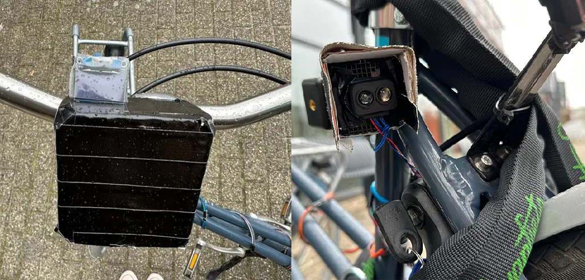
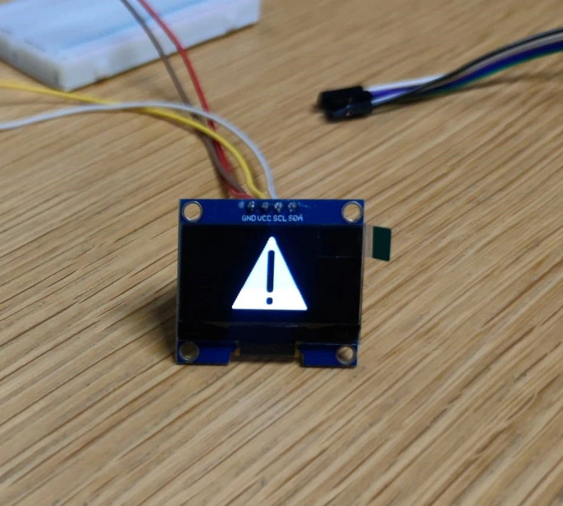
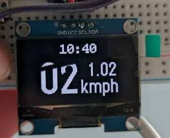
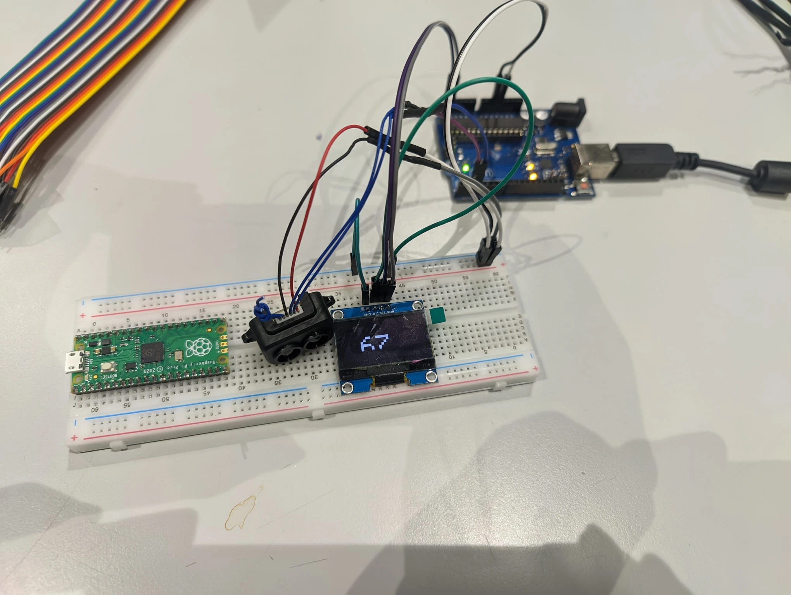

# Blind-spot warning device for bicycles

A small device that warns a cyclist when something comes up from behind. A LiDAR distance sensor is mounted at the back of the bike, and the unit on the handlebar shows your speed and the time on an OLED screen. When a car or another cyclist gets too close or approaches too fast, a big warning sign appears and a speaker beeps.

We built this in the **USE Engineering Design** course at Eindhoven University of Technology (2023). Two people left our group in the first weeks, so the three of us who stayed did a bit of everything, from soldering to programming to 3D-printing the cases.

> This repository contains only the Arduino sketches I wrote or co-wrote, not the full team project. The external libraries (TinyGPS++, U8g2, TFMPlus and others) are not included; you can install them through the Arduino Library Manager.

## What I worked on

- **GPS (most of the code):** reading the GPS module over UART, showing the speed in km/h and the local time on the OLED screen, and showing `??` instead of a speed when the signal quality (HDOP) is too poor to trust.
- **Sound warnings (on my own):** a slow beep for a nearby object and a faster, more urgent one.
- **LiDAR (together with a teammate):** reading the TF-Luna sensor at 20 Hz, turning the change in distance into an approach speed and smoothing it with a moving average before deciding to warn.
- **Warning sign:** I drew the warning sign as a font character in Fony and converted it for U8g2, so the OLED can draw it as one big glyph.
- **Hardware:** assembling and soldering the circuits, and testing every sensor on its own before combining them.

## What is in this repository

| Folder | What it does |
|---|---|
| `sketches/GPSsimpletest`, `GPSmodulelatlontest`, `GPSmodulespeed` | My first tests to get the GPS module talking over serial and reading position and speed |
| `sketches/GPSTinygps`, `GPSNeoLibrary` | Trying two different GPS libraries (TinyGPS++ and NeoGPS) to see which one works better |
| `sketches/GPS_speedv2` | The final GPS loop: speed, local time and the HDOP quality check, drawn on the OLED |
| `sketches/Lidar_Basic`, `Lidar_Working` | Reading distances from the TF-Luna LiDAR over UART |
| `sketches/Lidar_speedv2` | Approach speed from the change in distance, smoothed with a moving average, and the warning conditions |
| `sketches/Sound_Warning` | The two warning sounds for the speaker |
| `sketches/OLED_Warning` | Drawing the custom warning sign on the OLED |
| `sketches/Freq-speed` | A quick test of a doppler radar sensor as an option, based on an example by limpkin.fr |
| `warning-sign-font` | The warning sign as a BDF font and the converted C array for U8g2 |

## Hardware

Seeed Studio XIAO ESP32-C3 · Benewake TF-Luna LiDAR · GPS module · SH1106 1.3" OLED (I2C) · small speaker

---

Made by **Mariana Angelova** with two teammates · [Portfolio](https://AngelovaM2.github.io)
